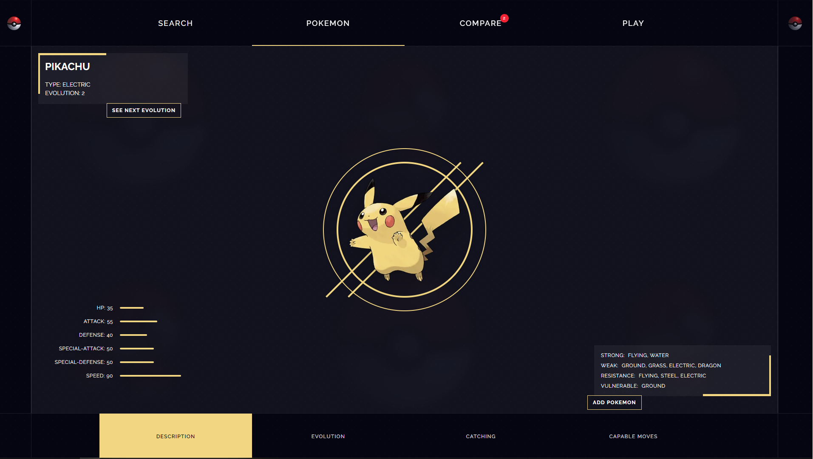

# Rotomdex

A modern Pokémon companion built with Next.js. Search for Pokémon, explore their details, compare stats and type matchups, or test your knowledge in a silhouette-guessing game.



## Features

- Search and browse Pokémon, with shuffle and load-more controls.
- Explore a Pokémon's types, base stats, strengths, weaknesses, evolutions, locations, and moves.
- Compare up to two Pokémon side by side.
- Play a silhouette-guessing game with difficulty settings, hints, and scoring.
- Fetch Pokémon data through cached requests and Next.js API routes backed by [PokéAPI](https://pokeapi.co/).

## Built with

- [Next.js](https://nextjs.org/) App Router and React
- TypeScript
- Tailwind CSS v4
- [TanStack Query](https://tanstack.com/query/latest) for server state
- [Zustand](https://zustand.docs.pmnd.rs/) for lightweight client state

## Getting started

### Requirements

- Node.js 20.9 or later
- npm

### Run locally

```bash
git clone https://github.com/taurusilver7/rotomdex.git
cd rotomdex
npm ci
npm run dev
```

Open [http://localhost:3000](http://localhost:3000) in your browser.

### Available scripts

| Command | Description |
| --- | --- |
| `npm run dev` | Start the development server |
| `npm run lint` | Run ESLint |
| `npm run build` | Create a production build |
| `npm run start` | Serve the production build |

Set `NEXT_PUBLIC_SITE_URL` to your deployed site's origin so generated metadata and social previews use the correct URL.

## Project structure

```text
app/          App Router pages and API route handlers
components/   Shared interface and interactive components
features/     Pokémon queries and feature-specific hooks
lib/          PokéAPI, caching, and Pokémon utilities
stores/       Zustand stores for comparison and UI state
public/       Static images and type icons
```

## Data and attribution

Pokémon data is provided by [PokéAPI](https://pokeapi.co/). Pokémon names, characters, and related artwork are the property of their respective owners. This is an independent fan project and is not affiliated with or endorsed by Nintendo, Game Freak, or The Pokémon Company.
